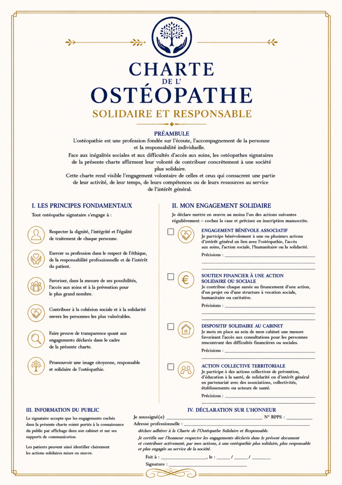

**Faire de la solidarité une valeur concrète de notre profession.**

Être ostéopathe, c’est exercer une profession qui repose sur la relation humaine, l’écoute et l’accompagnement des patients. C’est aussi avoir conscience des responsabilités que nous portons collectivement envers la société.

<!--more-->

Dans un contexte où les inégalités sociales et les difficultés d’accès aux soins demeurent une réalité, chaque ostéopathe peut, à son échelle, contribuer à faire évoluer les choses.

La Charte de l’Ostéopathe Solidaire et Responsable a été créée pour permettre à chacun de formaliser cet engagement et de le rendre visible auprès du public.

Au-delà de l’engagement individuel, la charte porte une ambition collective : démontrer que les ostéopathes sont des acteurs impliqués dans la vie sociale, capables de prendre leur part dans les enjeux de solidarité et d’accès aux soins.

Chaque signature renforce cette dynamique et participe à construire une image positive, responsable et citoyenne de l’ostéopathie.

Devenir Ostéopathe Solidaire et Responsable, ce n’est pas seulement afficher des valeurs. C’est prendre l’engagement de les faire vivre.

## Télécharger la charte

<a href="charte-osteopathe-solidaire-et-responsable.png" download>Télécharger la Charte de l’Ostéopathe Solidaire et Responsable au format PNG</a>

